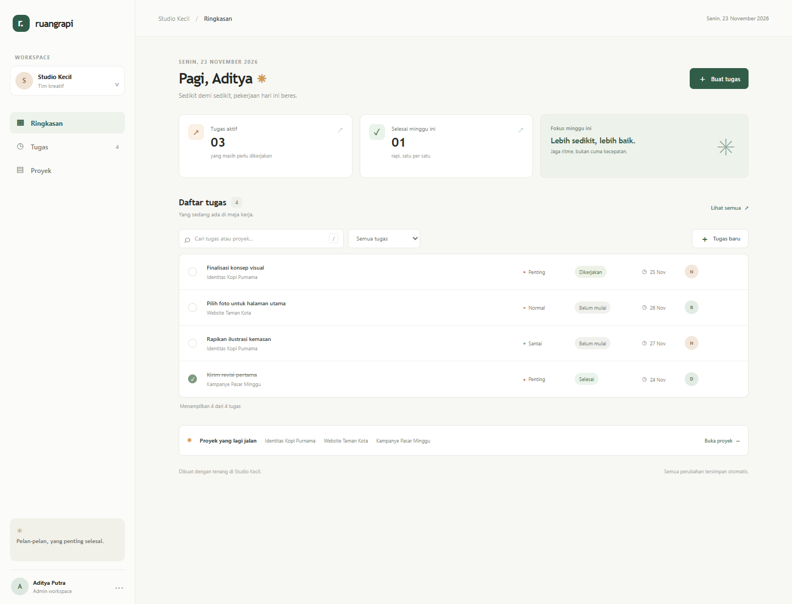
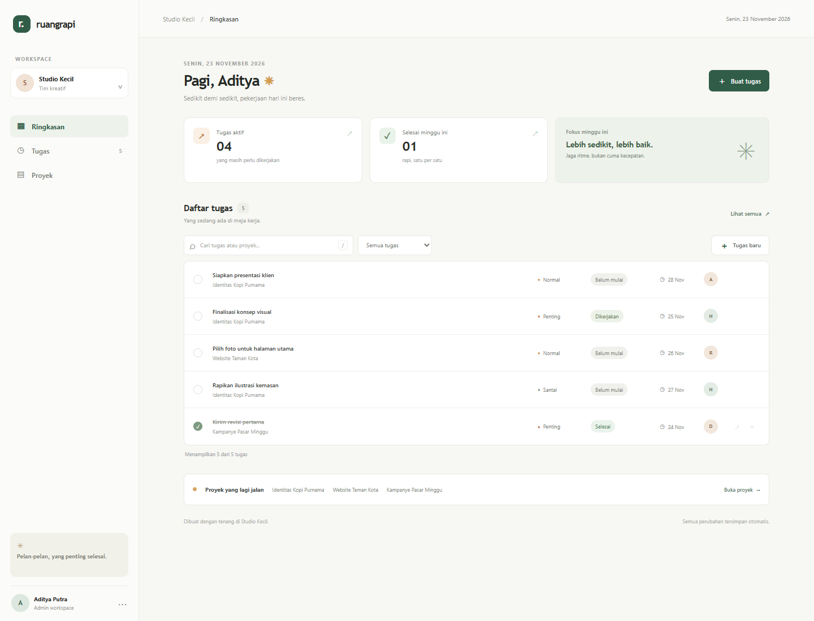
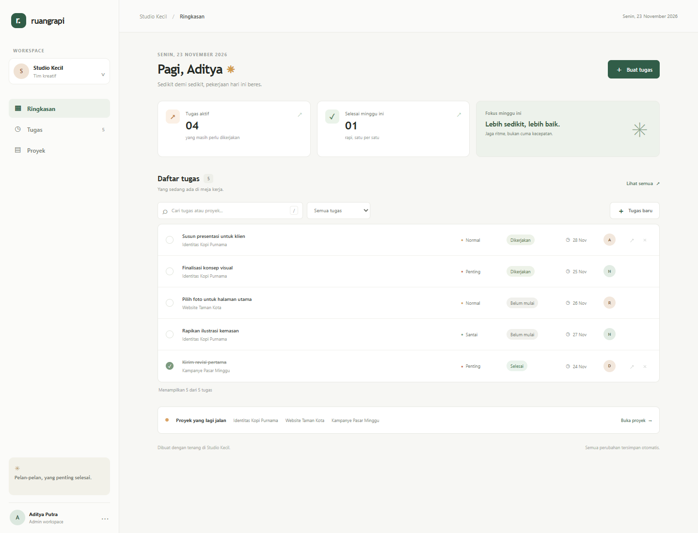

# RuangRapi

RuangRapi adalah dashboard ringan untuk tim kreatif kecil. Kelola daftar tugas, tenggat, prioritas, status, dan penanggung jawab dalam satu ruang kerja.

## Fitur

- CRUD tugas: buat, lihat, cari/filter, edit, dan hapus.
- Perubahan tersimpan otomatis di `localStorage` browser.
- Layout responsif, navigasi keyboard, label formulir, dan dialog native yang aksesibel.
- Data contoh langsung tersedia untuk mencoba dashboard.

## Menjalankan secara lokal

```bash
npm install
npm run dev
```

Buka [http://localhost:3000](http://localhost:3000).

## Validasi

```bash
npm run lint
npm run build
```

Proyek ini menggunakan Next.js App Router dan siap diimpor sebagai project Next.js di Vercel.

## Bukti CRUD (localhost)

**Review / Read**



**Create**



**Update**



**Delete**


